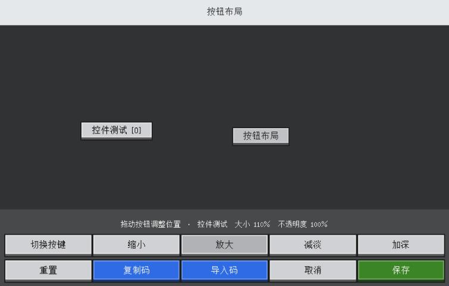
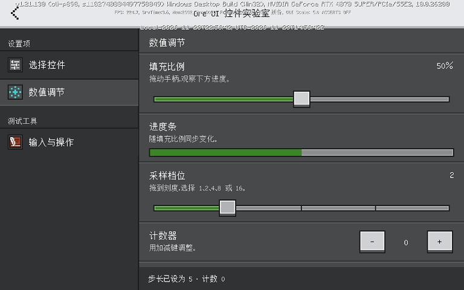

# Bedrock Ore UI Toolkit

为基岩版模组制作 Ore UI 风格设置页的控件模板、像素贴图库和 Codex 技能。附带一个可运行的网易 ModSDK 测试模组，可以在游戏中对照按钮、开关、分段选择、滑杆和输入框的交互。

[当前源码配套测试模组](OreUI控件实验室.mcaddon) · [GitHub 发布版本](https://github.com/TanShaoBig/bedrock-ore-ui-toolkit/releases)

## 在游戏中试用

在支持网易 ModSDK 的测试环境中同时启用行为包和资源包。进入测试世界后，点击 HUD 入口或按字母 **O** 打开实验室。切换左侧分类可体验这些控件。

- 从 HUD 的「按钮布局」或「输入与操作 → 按钮布局」打开编辑器。拖动后可调大小与透明度，保存到本机或复制布局码。参见[接入说明](bedrock-ore-ui/references/hud-layout.md)。
- 滑杆立即更新数值，方形手柄和绿色轨道带横向阻尼跟随指针。
- 分段选择项在松手后保持下沉。离开分类再返回，选中的档位仍会回显。
- 开关使用可反向播放的过渡动画。操作页还可以试用输入框、计数反馈和不同用途的按钮。

## 在自己的项目中使用

| 内容 | 入口 |
| --- | --- |
| 独立素材库 | [53 张贴图总览](素材库/texture_catalog.png) · [文件名、尺寸与用途](素材库/素材清单.md) |
| Codex 技能 | [技能入口](bedrock-ore-ui/SKILL.md) · [控件模板](bedrock-ore-ui/assets/ui/ore_style.json) |
| 测试模组源码 | [行为包](OreUI控件实验室/behavior_packs/OreLabBP) · [资源包](OreUI控件实验室/resource_packs/OreLabRP) |
| 安装与复用 | [使用说明](使用说明.md) |

将整个 `bedrock-ore-ui` 文件夹放入个人 Codex 技能目录。在新会话中说“需要 OreUI 风格”，或直接使用 `$bedrock-ore-ui`。

源码、技能文档和随附贴图使用 [MIT 许可证](LICENSE)。

## 验证当前源码

运行 `python -B tools/check_toolkit.py` 检查资源、模板、回归用例和安装包一致性。修改源码后加 `--build` 重新打包再校验。需要 Python 3.8 或更高版本。仓库在推送和拉取请求时运行同一条命令。
